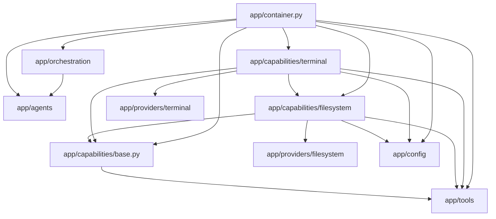
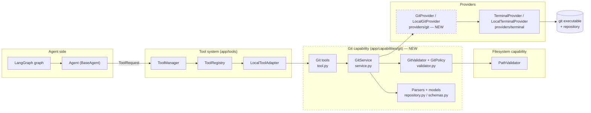
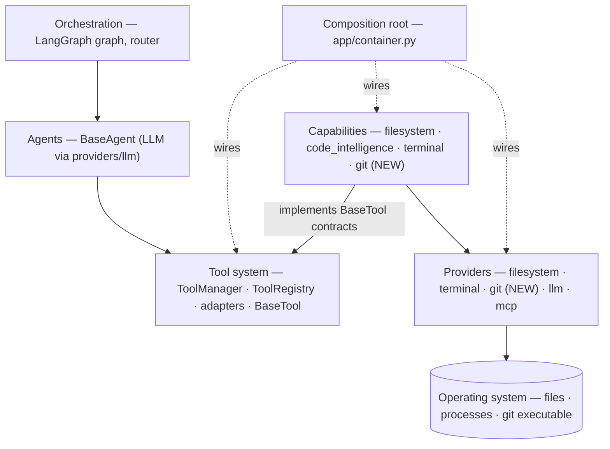
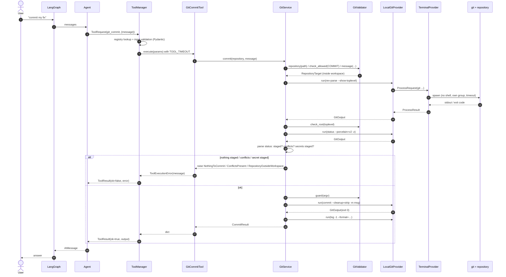
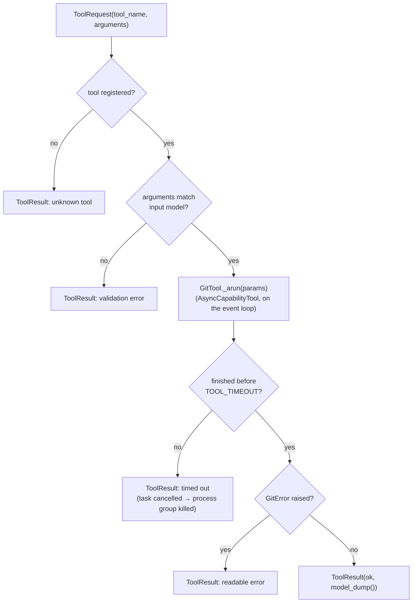
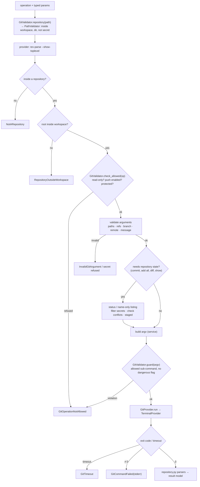
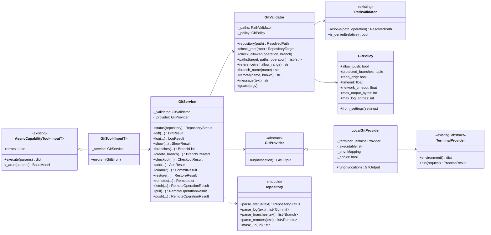
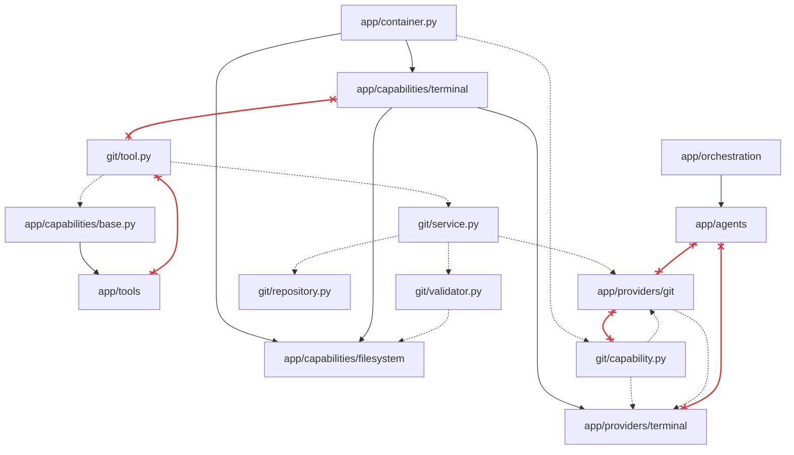

# Architecture Diagrams: Git Capability

Mermaid diagrams (rendered by GitHub and the VS Code Markdown preview). Diagram 0 is **generated by
Graphify** from the current code; diagrams 1–7 are the design. Every existing dependency the design relies
on, and every forbidden path, is checked against the Graphify graph. See
[graphify/validation.md](graphify/validation.md).

Legend: dashed boxes and links are **new**; solid ones exist today.

## 0. As-is dependencies (generated by Graphify)

Produced by `validate_design.py --as-is` from `graphify-out/graph.json`, which holds 1461 nodes and 4142 edges
extracted from the AST. It covers the packages the Git capability will plug into.

Observations used by the design:

- `agents` and `orchestration` reach neither capabilities nor providers, so the Tool Manager is the only
  gateway (rule checked).
- The Terminal capability already reuses `capabilities/filesystem`, through `PathValidator`, and
  `providers/terminal`. The Git capability follows the same shape.
- Only `container.py` knows every capability (composition root).

## 1. Component diagram

## 2. Layer diagram

## 3. Sequence diagram — `git_commit`

## 4. Tool execution flow

## 5. Git operation flow (inside `GitService`)

## 6. Class diagram

## 7. Dependency diagram (to-be, module level)

Solid links: exist today, **validated by Graphify** (EXISTING). Dashed links: created by this sprint
(PLANNED, validated after implementation with `--phase implemented`). Red links: must never exist
(FORBIDDEN, validated now and after).

`x--x` = forbidden dependency (checked as "no path", direct or transitive).
