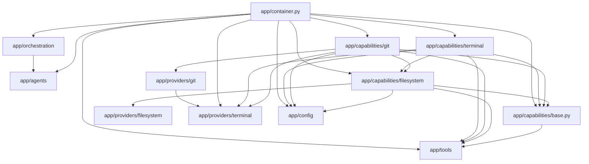

# Design Validation Report

**Date**: 2026-11-27 · **Phase**: design (before implementation)
**Graph**: `graphify-out/graph.json` built at commit `11577de`. The repository HEAD is `11577de`, so the
graph matches the code (Sprint 6 included).

## 1. Architecture against the Graphify knowledge graph

Command:

```bash
graphify update .
$(cat graphify-out/.graphify_python) specs/001-git-capability/graphify/validate_design.py
```

Graphify builds the graph from the real source code (Python AST: imports, calls, inheritance). The
script reduces it to module-level dependencies inside `app/` and checks the design's assumptions.

The detector was sanity-checked on paths that do exist:

- `container.py → capabilities/terminal/capability.py → providers/terminal/local.py`
- `orchestration/graph.py → agents/base/agent.py`

It finds both, so a FORBIDDEN rule marked `[x]` means "no path exists", not "nothing was searched".

Result:

```text
## EXISTING: dependency must exist
- [x] app/capabilities/terminal/capability.py -> app/providers/terminal (process provider to reuse): app/capabilities/terminal/capability.py -> app/providers/terminal/__init__.py
- [x] app/capabilities/terminal/validator.py -> app/capabilities/filesystem (PathValidator to reuse): app/capabilities/terminal/validator.py -> app/capabilities/filesystem/__init__.py
- [x] app/capabilities/terminal/executor.py -> app/providers/terminal (executor builds ProcessRequest): app/capabilities/terminal/executor.py -> app/providers/terminal/__init__.py
- [x] app/capabilities/base.py -> app/tools (AsyncCapabilityTool extends BaseTool): app/capabilities/base.py -> app/tools/__init__.py
- [x] app/capabilities/terminal/tool.py -> app/capabilities/base.py (tools extend AsyncCapabilityTool): app/capabilities/terminal/tool.py -> app/capabilities/base.py
- [x] app/container.py -> app/capabilities/terminal (composition root registers capabilities): app/container.py -> app/capabilities/terminal/__init__.py
- [x] app/container.py -> app/capabilities/filesystem (filesystem service shared by capabilities): app/container.py -> app/capabilities/filesystem/__init__.py
- [x] app/tools/manager.py -> app/tools/registry.py (ToolManager looks tools up in the registry): app/tools/manager.py -> app/tools/registry.py
- [x] app/tools/adapters/local.py -> app/tools/base.py (LocalToolAdapter wraps BaseTool): app/tools/adapters/local.py -> app/tools/base.py
- [x] app/orchestration -> app/agents (graph nodes call the agent): app/orchestration/graph.py -> app/agents/base/__init__.py
## FORBIDDEN: no dependency path may exist
- [x] app/agents -/-> app/capabilities (agents act only through the Tool Manager)
- [x] app/agents -/-> app/providers/terminal (agents never start processes)
- [x] app/agents -/-> app/providers/git (agents never run git)
- [x] app/orchestration -/-> app/providers/terminal (graph never starts processes)
- [x] app/orchestration -/-> app/providers/git (graph never runs git)
- [x] app/tools -/-> app/capabilities (tool system does not know capabilities)
- [x] app/providers -/-> app/capabilities (providers depend on nothing above them)
- [x] app/capabilities/terminal -/-> app/capabilities/git (capabilities stay independent)
- [x] app/capabilities/git -/-> app/capabilities/terminal (git reuses the provider, not the terminal capability)

OK (204 module edges, 55 modules)
```

**Conclusion**: every existing dependency the design reuses is real. The TerminalProvider and the
filesystem PathValidator are already shared the way the design needs. None of the layering rules the Git
capability must respect is violated today. The PLANNED rules (diagram 7, dashed links) are checked after
implementation with `--phase implemented`.

## 2. Diagram syntax

All 8 Mermaid blocks of [diagrams.md](../diagrams.md) were parsed with the official `mermaid` 11 parser.
The parser and the script live outside the repository, in the session scratchpad.

```text
OK    flowchart-v2     0. As-is dependencies (generated by Graphify)
OK    flowchart-v2     1. Component diagram
OK    flowchart-v2     2. Layer diagram
OK    sequence         3. Sequence diagram — git_commit
OK    flowchart-v2     4. Tool execution flow
OK    flowchart-v2     5. Git operation flow (inside GitService)
OK    classDiagram     6. Class diagram
OK    flowchart-v2     7. Dependency diagram (to-be, module level)
8/8 diagrams valid
```

## 3. Consistency between diagrams and checks

| Diagram 7 link kind | Count | Checked by |
|---|---|---|
| solid (exists today) | 6 | EXISTING: all 6 present |
| dashed (planned) | 10 | PLANNED: 10 rules, run after implementation |
| red (forbidden) | 5 | FORBIDDEN: all absent today, re-checked after implementation |

## 4. What Graphify cannot validate

Graphify extracts what the code *is*. It cannot check behaviour or intent, for example the order of the
messages in the sequence diagram or the security decisions. Those are covered by the spec's acceptance
scenarios and by the tests planned in [plan.md](../plan.md).

---

# Implementation Validation (phase: implemented)

**Date**: 2026-11-27. The graph was rebuilt with `graphify update .` after implementation: 1917 nodes, 5511
edges, 106 communities.

## 5. Architecture of the implemented code

Command:

```bash
$(cat graphify-out/.graphify_python) specs/001-git-capability/graphify/validate_design.py --phase implemented
```

```text
## EXISTING: dependency must exist
- [x] app/capabilities/terminal/capability.py -> app/providers/terminal (process provider to reuse): app/capabilities/terminal/capability.py -> app/providers/terminal/local.py
- [x] app/capabilities/terminal/validator.py -> app/capabilities/filesystem (PathValidator to reuse): app/capabilities/terminal/validator.py -> app/capabilities/filesystem/__init__.py
- [x] app/capabilities/terminal/executor.py -> app/providers/terminal (executor builds ProcessRequest): app/capabilities/terminal/executor.py -> app/providers/terminal/environment.py
- [x] app/capabilities/base.py -> app/tools (AsyncCapabilityTool extends BaseTool): app/capabilities/base.py -> app/tools/__init__.py
- [x] app/capabilities/terminal/tool.py -> app/capabilities/base.py (tools extend AsyncCapabilityTool): app/capabilities/terminal/tool.py -> app/capabilities/base.py
- [x] app/container.py -> app/capabilities/terminal (composition root registers capabilities): app/container.py -> app/capabilities/terminal/__init__.py
- [x] app/container.py -> app/capabilities/filesystem (filesystem service shared by capabilities): app/container.py -> app/capabilities/filesystem/__init__.py
- [x] app/tools/manager.py -> app/tools/registry.py (ToolManager looks tools up in the registry): app/tools/manager.py -> app/tools/registry.py
- [x] app/tools/adapters/local.py -> app/tools/base.py (LocalToolAdapter wraps BaseTool): app/tools/adapters/local.py -> app/tools/base.py
- [x] app/orchestration -> app/agents (graph nodes call the agent): app/orchestration/graph.py -> app/agents/base/__init__.py
## PLANNED: dependency must exist
- [x] app/capabilities/git/capability.py -> app/providers/git (assembly creates LocalGitProvider): app/capabilities/git/capability.py -> app/providers/git/__init__.py
- [x] app/providers/git/local.py -> app/providers/terminal (git runs through TerminalProvider): app/providers/git/local.py -> app/providers/terminal/environment.py
- [x] app/capabilities/git/validator.py -> app/capabilities/filesystem (workspace rules reused): app/capabilities/git/validator.py -> app/capabilities/filesystem/__init__.py
- [x] app/capabilities/git/capability.py -> app/providers/terminal (assembly injects TerminalProvider): app/capabilities/git/capability.py -> app/providers/terminal/local.py
- [x] app/capabilities/git/tool.py -> app/capabilities/base.py (tools extend AsyncCapabilityTool): app/capabilities/git/tool.py -> app/capabilities/base.py
- [x] app/capabilities/git/tool.py -> app/capabilities/git/service.py (tools call the service): app/capabilities/git/tool.py -> app/capabilities/git/service.py
- [x] app/capabilities/git/service.py -> app/capabilities/git/validator.py (service validates first): app/capabilities/git/service.py -> app/capabilities/git/validator.py
- [x] app/capabilities/git/service.py -> app/capabilities/git/repository.py (service parses via repository): app/capabilities/git/service.py -> app/capabilities/git/repository.py
- [x] app/capabilities/git/service.py -> app/providers/git (service runs git via GitProvider): app/capabilities/git/service.py -> app/providers/git/__init__.py
- [x] app/container.py -> app/capabilities/git (composition root registers the git capability): app/container.py -> app/capabilities/git/capability.py
## FORBIDDEN: no dependency path may exist
- [x] app/agents -/-> app/capabilities (agents act only through the Tool Manager)
- [x] app/agents -/-> app/providers/terminal (agents never start processes)
- [x] app/agents -/-> app/providers/git (agents never run git)
- [x] app/orchestration -/-> app/providers/terminal (graph never starts processes)
- [x] app/orchestration -/-> app/providers/git (graph never runs git)
- [x] app/tools -/-> app/capabilities (tool system does not know capabilities)
- [x] app/providers -/-> app/capabilities (providers depend on nothing above them)
- [x] app/capabilities/terminal -/-> app/capabilities/git (capabilities stay independent)
- [x] app/capabilities/git -/-> app/capabilities/terminal (git reuses the provider, not the terminal capability)
## FORBIDDEN (direct)
- [x] app/capabilities/git/service.py -/-> app/providers/terminal (service talks to GitProvider only)
- [x] app/capabilities/git/tool.py -/-> app/providers (tools talk to the service only)

OK (253 module edges, 63 modules)
```

All **10 PLANNED** links of diagram 7 now exist in the code. All **11 FORBIDDEN** rules still hold: the 9
path rules and the 2 direct rules (the service and the tools never import the terminal provider).

## 6. As-implemented dependencies (generated by Graphify)



This matches the to-be design (diagram 7):

- `capabilities/git` depends on `capabilities/filesystem` (PathValidator), `capabilities/base.py`,
  `providers/git` and `providers/terminal`. The last one comes only from `capability.py`, which injects
  it.
- `providers/git` depends only on `providers/terminal`.
- There is no link between `capabilities/git` and `capabilities/terminal`, and no link from `agents` or
  `orchestration` to any provider.
